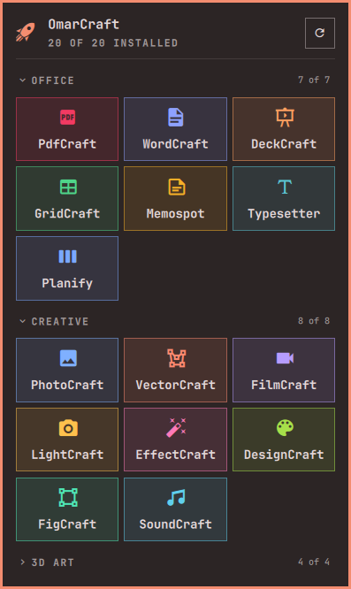

# OmarCraft

Productivity tools from the Omarchy bar: the ArtCraft Craft apps and more.



OmarCraft is for people who come to Omarchy for office, design and creative work, not only for code: simple,
powerful desktop tools behind one bar icon, with a native Omarchy panel that shows what is installed, what
is not, what has a newer build, and one action per tool to launch, install, update or remove. Every tool is
a prebuilt package, from a package repo (Omarchy's own or the Arch repos) or a `-bin` from the AUR,
installed through Omarchy's own package commands, so pacman owns it and nothing is ever compiled.

It carries the apps in [ArtCraft](https://getartcraft.com)'s own list, seventeen in November 2026, plus three
tools that do what ArtCraft does not (see *Beyond ArtCraft*), in three categories:

- **Creative:** PhotoCraft, VectorCraft, LightCraft, DesignCraft, FigCraft, FilmCraft, EffectCraft, SoundCraft
- **3D Art:** CADCraft, SolidCraft (a community app by Tangency Labs, in ArtCraft's list), TextureCraft,
  MaterialCraft
- **Office:** WordCraft, GridCraft, DeckCraft, PdfCraft, Typesetter, Memospot, Planify

and, on its own line at the bottom of the panel, **Craft Anything**, ArtCraft's AI coding agent (early
alpha). The list comes from ArtCraft's launcher, so an app ArtCraft adds shows up without a new OmarCraft;
one OmarCraft has no category for yet lands in Creative.

Plugin id `omarcraft.productivity`. MIT licensed. **Unofficial**: OmarCraft is not made by or affiliated with
Storyteller, the makers of ArtCraft, nor with the projects behind the other tools. The names are theirs.

## Beyond ArtCraft

A tool gets a tile when it:

1. has a stable desktop release (tagged, not a release candidate or a source-only build),
2. ships prebuilt, in a package repo (the Arch repos or Omarchy's own) or as an AUR `<id>-bin`, with a
   desktop entry,
3. comes from a maintained upstream under an open-source licence,
4. stays near **150 MiB idle in one native process**, like the Craft apps (70–90 MiB measured),
5. does something an office, design or creative user wants on the desktop,
6. **works with others**: its work can be shared and taken elsewhere, through an open file format or a
   sync or sharing service the user chooses, with a way to export it.

Item 6 is a foundation of every tool beyond ArtCraft: a tile never locks your work into one computer or
one app. A tool that adds a capability ArtCraft lacks may exceed item 4; its row says so. Today:

| Tool | Group | Package | What it is | Idle memory (measured) |
|---|---|---|---|---|
| [Typesetter](https://codeberg.org/haydn/typesetter) | Office | `typesetter` (Arch repos) | A focused [Typst](https://typst.app) editor with a live preview | 57 MiB, 1 process |
| [Memospot](https://memospot.github.io) | Office | `memospot-bin` | [Memos](https://usememos.com), the notes and journal service, as a desktop app | 371 MiB, 4 processes · **exception**: web-based |
| [Planify](https://useplanify.com) | Office | `planify` (Arch repos) | Tasks and projects, each one a list or a kanban board, kept on your computer (Todoist, Nextcloud or CalDAV sync optional) | 153 MiB, 1 process |

Typesetter and Planify come from the Arch repos: they install with Omarchy's repo command and update with
the system (see *Updates*).

### Working with others

Each tool works alone, offline, on your computer. Working with others goes through what the tool already
speaks; OmarCraft installs the desktop apps and changes nothing on any server.

| Tool | Share and collaborate | Take your work elsewhere |
|---|---|---|
| Typesetter | Documents are plain-text [Typst](https://typst.app) files: share them through Git or any file sync, or open them in typst.app, Typst's web editor, to write together in real time. Comments in the source mark review notes | Typst source files and the PDFs they render |
| Memospot | Point it at a shared [Memos](https://usememos.com) server you run (client mode): accounts with roles, each memo private, visible to the server's members, or public, with comments and reactions. Its built-in server serves only your own computer | Personal export and import in Settings; notes move between a local Memospot and a hosted Memos server; an API, webhooks and an MCP server for your own tools |
| Planify | Sync a project with Nextcloud Deck to share kanban boards, with Todoist to share projects and assign tasks, or with any CalDAV server (Nextcloud and others) to share task lists | CalDAV tasks are the standard calendar and to-do format, readable by Thunderbird, phone task apps and others; full JSON backups |

**Vikunja (0.5.0 only).** OmarCraft 0.5.0 carried Vikunja and 0.5.1 dropped it: its desktop app signs in
only through the browser, and on a stock Omarchy that hand-off kept failing. If you installed it with
0.5.0, OmarCraft deletes the desktop entry it wrote for it and tells you once. Your Vikunja data stays in
`~/.local/share/omarcraft/vikunja`; the app is removed like any package:
`omarchy pkg drop vikunja-desktop-bin vikunja-bin`. Its tray icon stays on the bar's tray Hide list,
where 0.5.0 put it; the tray's own settings show it again.

To propose a tool, or suggest any new addition, open an issue or email **correlate@entangledforge.com**
with the package name and the upstream — proposals are welcome. Tools that only exist as a server or a
command-line program (Typst's compiler, the Memos server itself) are not tiles: nothing to launch.

## Requirements

- Omarchy 4 (Quattro); tested on Omarchy 4.5. Nothing else: the plugin uses Omarchy's bundled tools (`curl`, `jq`, the AUR
  helper behind `omarchy-pkg-aur-add`) and no Python or extra packages.

## Install

```bash
omarchy plugin add https://github.com/dreamsgarage/OmarCraft.git --enable
```

The rocket icon lands in the right section of the bar, with the other panels. Enabling installs no app
and writes no configuration; nothing happens until you pick something in the panel. If the add prints
"omarchy-shell is not responding", the shell was still reloading; `omarchy plugin enable
omarcraft.productivity` finishes the placement.

To upgrade from any earlier version, update the plugin, then restart the shell so the panel loads the new
code. Your apps are not touched and nothing new is installed:

```bash
omarchy plugin update omarcraft.productivity --yes
omarchy restart shell
grep '"version"' ~/.config/omarchy/plugins/omarcraft.productivity/manifest.json   # the latest release
```

Every release upgrades this way, 0.1.0 included: the history only moves forward, and
`tests/upgrade-paths.sh` upgrades each earlier release before a new one ships. The update refuses, with
*cannot fast-forward* or *local changes*, only when files in the plugin folder were edited or copied over
(for example with `rsync`), and with *not a git checkout* when the folder is not a clone. Then reinstall
the plugin; your apps and their files stay:

```bash
omarchy plugin remove omarcraft.productivity --yes
omarchy plugin add https://github.com/dreamsgarage/OmarCraft.git --enable --yes
omarchy restart shell
```

## The panel

Left-click the icon (or `Tab` from a neighbouring panel). No version numbers anywhere: an app has an
update or it does not (the command line still shows versions, see below).

- **Hero.** The rocket logo, then the one-line situation: `16 OF 20 INSTALLED · 2 UPDATES` (the
  updates part in the urgent colour), `INSTALLING WORDCRAFT…`, `NOTHING INSTALLED YET`, `OFFLINE · CACHED
  LIST`, `LAST JOB FAILED`. The circular arrow at the right checks the AUR now; its tooltip says how old
  the list is. A line under the hero appears only while something needs saying (a job, an error, offline).
- **After an update**, one line: `✓ Updated PhotoCraft and WordCraft`. It goes on the next key, after a
  few seconds, or when the panel closes.
- **UPDATES · N.** Shown only when newer builds exist: the apps' names and an *Update all · u* button.
  The apps stay in their category with an **Update** badge; `Enter` on one asks: *Update ⏎* (that
  package), *Launch instead*, *Cancel*.
- **Categories.** Creative, 3D Art and Office, each one header line: its name, `3 of 4` installed, a dot
  while an app in it has an update, *New* while it has an app you have not seen, and its key while
  something in it is missing. `Enter` or a click on the header opens or closes it, and the panel remembers.
  A category opens by itself when it gets a new app. Inside, the apps show as **tiles** (default: three per
  line, each the app's glyph in its own ArtCraft colour over its name; installed ones tinted, the others
  outlined) or **rows** (one per line with a caption), switched live with `t` or
  `omarchy bar set omarcraft.productivity layout tiles|rows`. `Enter` or a click launches an installed app
  (or focuses its window) and opens a one-line confirm for one that is not (`Install PhotoCraft · a
  terminal will open and ask for your password`); `Enter` again runs it, `Esc` cancels. An open category
  with apps missing ends with *Install N*, the same as its key: one confirm, one terminal, one run.
- **Craft Anything**, alone on the last line, never collapsed: `Enter` installs, launches or updates it.
- **Remove.** Right-click an installed tile, or press `x` with the cursor on it: `Remove PhotoCraft · a
  terminal will open and ask for your password · your files stay`, then *Remove ⏎* or *Cancel*. The job
  is Omarchy's `omarchy pkg drop photocraft-bin`. Apps installed some other way are not offered.

While a job runs the row shows a spinner and `Installing…`, the hero says what runs, every install action
is greyed out, and the terminal is the place to type your password. When the terminal finishes the panel
re-reads the package database: what you see is what is installed, never what a click intended.

**Keys:** `h`/`l` `j`/`k` move (tiles: one tile, one line) · `Enter` open or close a category, or launch,
update or install an app · `u` Update all · `x` remove the app under the cursor · `c` / `3` / `o` install
the missing Creative / 3D Art / Office tools · `r` check the AUR · `t` switch layout ·
`Tab` neighbouring panel · `Esc` cancel or close.

**Bar icon:** a rocket (󰓄), left = panel · right = check the AUR now · middle = switch layout. It turns to
the urgent colour while updates are pending, with the count in front (`2 󰓄`), when a Craft app appeared in
the catalog since you last opened the panel, and after a job that failed.

## Updates

Every six hours, and whenever you press `r` or right-click the icon, OmarCraft compares your installed
AUR `-bin` packages with the AUR. Newer builds show on the tiles or rows and on the icon; the six-hourly check
also sends one desktop notification per new set, which opens the panel. If the AUR cannot be reached the
hero says `OFFLINE · CACHED LIST` and the panel retries on its own every ten minutes. Updates are package-exact: `Enter` on the app updates that
one, *Update all* (`u`) every app with a newer build, each on its own, in a floating terminal that asks for
your password; only when nothing but tools from the Arch repos is pending does it run Omarchy's update.
`omarchy update` updates them too. "Newer" means a newer
AUR build exists, which can trail an ArtCraft release by a day or so.

**Craft apps that Omarchy's repo also ships.** Omarchy's own repo ships WordCraft and GridCraft under
their AUR names (`wordcraft-bin`, `gridcraft-bin`), but its builds can trail ArtCraft's releases, while the
AUR's `-bin` packages download ArtCraft's own release files within hours. Since 0.5.7 OmarCraft takes these
apps from the AUR, like every other Craft app: their update badge follows the AUR's build, and installs and updates
name the AUR explicitly (`yay -S aur/wordcraft-bin`), since pacman and the AUR helper otherwise take a
package from a repo when one ships it. There is only ever one copy: both builds use the same package name,
so the AUR build replaces Omarchy's in place, documents and settings untouched. Omarchy's update never
downgrades it (pacman keeps a newer local build and says so in one warning line); when Omarchy's repo has
a newer build than the installed one, Omarchy's update brings that build, which is fine, and OmarCraft
offers the AUR's next release once it is newer. If the AUR ever has no build of such an app, the app
follows Omarchy's repo instead. (0.5.4 to 0.5.6 followed Omarchy's repo for these apps; that code is kept,
switched off, until Omarchy answers [omacom/omarchy-pkgs#2390](https://github.com/omacom/omarchy-pkgs/issues/2390).)

**Tools from the Arch repos** (Typesetter, Planify) come from those repos, installed or not, and install
with Omarchy's `omarchy-pkg-add`. Each check reads the repos as they are now, the way Omarchy's own update
check does: `checkupdates` refreshes a private copy of the package lists (about 9 MB in
`~/.cache/omarchy/omarcraft/checkup-db`) without a password and without touching the system's, which are
only as new as its last update. Their *Update* badge opens Omarchy's update instead (the confirm says so), because updating
one of those packages on its own is a partial upgrade; *Update all* runs Omarchy's update when only these
are pending.

**The apps' own update prompts.** A Craft app may announce a new version itself ("Update and restart")
as soon as ArtCraft releases it. Its own updater cannot replace a package that pacman installed (it fails
with "Permission denied"): update the app from OmarCraft instead. The AUR package usually has the new build
within hours of the release; until it does, OmarCraft shows none.

## Apps installed some other way

OmarCraft recognises apps it did not install and never removes or replaces anything on its own.

| How the app got there | In the panel |
|---|---|
| `<app>-bin` from the AUR by any means | Installed; launches; counted for updates against the AUR |
| `<app>-bin` from Omarchy's repo (it ships `wordcraft-bin` and `gridcraft-bin`) | Installed; launches; counted for updates against the AUR: the next AUR build replaces Omarchy's |
| Source build (`<app>`, e.g. via `storytold-office` or `storytold-suite`) | Installed; launches; reads `Source build · updates via omarchy update`; never in OmarCraft's update checks (updating it would compile again) |
| AppImage or Flatpak from the official ArtCraft Launcher | Not detected; the panel offers the `-bin` package. Remove the other copy first if you want one |

To move a source build to the prebuilt package, remove it and install the `-bin` one with Omarchy's
command; the bundle packages stay satisfied because each `-bin` package provides the app name:

```bash
omarchy pkg drop wordcraft && omarchy-pkg-aur-add wordcraft-bin
```

## Command line and IPC

Everything the panel does is a subcommand of one script, usable from scripts and keybindings:

```
P=~/.config/omarchy/plugins/omarcraft.productivity/bin/omarcraft
$P state                      # the JSON the panel reads (local files only)
$P list                       # catalog with install state
$P launch <id>                # e.g. photocraft
$P install <id>...            # floating terminal, one run
$P install-group all|creative|3d|office   # notes: office, as before 0.5.8
$P remove <id>...             # floating terminal, Omarchy's pkg drop; your files stay
$P update [id...]             # the named apps, or every app with a newer build; floating terminal
$P check [--notify]           # pending updates; exit 0 if any
                              # list and check show versions; while ArtCraft's list cannot be read
                              # (its layout changed), both say so on stderr
$P refresh [-f]               # fetch catalog and AUR versions now
```

```
omarchy-shell omarcraft.productivity open | close | toggle | refresh
omarchy-shell omarcraft.productivity launch <id>
omarchy-shell omarcraft.productivity install "<id> <id>"      # no confirm: a script is explicit
omarchy-shell omarcraft.productivity update "<id> <id>"      # or "" for every app with a newer build
omarchy-shell omarcraft.productivity remove "<id> <id>"      # apps installed as -bin packages
omarchy-shell omarcraft.productivity layout tiles|rows
omarchy-shell omarcraft.productivity status                   # JSON
```

A keybinding, if you want one (`Super + Alt + A` is free on a default Omarchy 4 install), in
`~/.config/hypr/bindings.lua`:

```lua
o.bind("SUPER + ALT + A", "OmarCraft", "omarchy-shell omarcraft.productivity toggle")
```

An ArtCraft section in the Omarchy menu (`Super + Alt + Space` root and *Install → ArtCraft*), opt-in and
reversible: `$P setup-menu` / `$P remove-menu`. It writes one marked block into
`~/.config/omarchy/extensions/omarchy-menu.jsonc` and nothing else. Since 0.5.8 its install entries are Creative, 3D Art
and Office; a section written by an earlier version still works (its *Install Notes* now installs what
Office is missing), and `$P setup-menu` again brings the new entries.

## Remove

```bash
omarchy plugin remove omarcraft.productivity
```

Apps stay installed; remove them from the panel first if you want (right-click a tile), or like any
package, e.g. `omarchy pkg drop photocraft-bin`. Optional clean-up:

```bash
rm -rf ~/.cache/omarchy/omarcraft ~/.local/state/omarchy/omarcraft   # catalog cache, job records, seen list
```

plus `$P remove-menu` before removing if you ran `setup-menu`, and the keybinding line if you added it.

## Safety

- Only catalog apps reach a package command, by an id checked against a strict pattern; each maps to a
  package: `<id>-bin` by default, or a fixed name for a tool whose package differs (`typesetter`). A
  package a configured repo ships (the Arch repos or Omarchy's own, read from the local sync databases) is
  a repo package, installed or not: it installs through `omarchy-pkg-add` and updates with the system. Any
  other is an AUR package.
  The plugin does not use sudo or pkexec. Installs go through Omarchy's `omarchy-pkg-aur-add` (AUR) or `omarchy-pkg-add`
  (repo packages); updates call the AUR helper Omarchy ships for exactly the named AUR packages, and for
  one package from Omarchy's repo at a time (from its https address, pacman checking its signature, and
  only when nothing else would change); tools from the Arch repos update with the system through
  Omarchy's update; removals go through Omarchy's
  `omarchy-pkg-drop`, which takes the package and the dependencies nothing else needs, never your
  documents or settings. Each runs in a visible Omarchy terminal that asks for your password itself; a
  job cut short (terminal closed, `Ctrl+C`) is reported as interrupted. Before an AUR install or update,
  OmarCraft checks the package's declared dependencies: if one is neither installed nor in the Arch repos,
  the AUR helper would compile it, so the job stops before anything is installed and says which one.
- Network use: the app catalog from `raw.githubusercontent.com` (storytold/craft-launcher) and versions
  from the AUR RPC, every six hours, with bounded timeouts; the package lists of the configured repos through `checkupdates`, into a private copy. A failed check keeps the old list and says `OFFLINE`, never "up to date". The panel
  itself never waits on the network.
- What comes from the network is untrusted and bounded: a download stops at a size (256 KB for the
  catalog, 1 MB for an AUR answer; a longer one is refused whole), and only well-formed records are kept
  (a plain id, a name of at most 48 characters and a tagline of at most 96 without control characters,
  `#rrggbb` colours, version strings that look like versions, at most 64 apps). The panel's own data is
  bounded again on the way out, so neither a hostile nor a broken answer can fill the shell's memory.
- Files: `~/.cache/omarchy/omarcraft/` (catalog, what the configured repos ship of it, and the private copy
  of the package lists the repo check uses) and `~/.local/state/omarchy/omarcraft/` (job records,
  seen apps, notification state). Nothing under `~/.config` without the opt-in commands. Where 0.5.0
  installed Vikunja, 0.5.1 deletes, once, the two files 0.5.0 wrote for it: its desktop entry in
  `~/.local/share/applications` and that entry's launcher.

## How it works

| Path | Role |
|---|---|
| `manifest.json` | `kinds: ["bar-widget"]`, entry point `Panel.qml`, default section right |
| `Panel.qml` | Bar icon, `KeyboardPanel`, both layouts, cursor, confirm, keys, IPC |
| `AppTile.qml` | One tile: glyph in the app's ArtCraft colour over its name |
| `AppRow.qml` | One row: glyph · name · subtext · right-edge action, Network-panel style |
| `Service.qml` | Runs `bin/omarcraft state`, watches `job.json`, six-hourly check |
| `Model.js` | Pure helpers: sections, meta line, subtexts, confirm text |
| `bin/omarcraft` | Catalog, installed state, jobs, launch, the opt-in menu section |
| `tests/` | `bash tests/run.sh`: offline, every external command stubbed |
| `docs/` | Approved plan, spec, design, acceptance, research, testing and publish guides |

A job is one floating Omarchy terminal running `bin/omarcraft job install …` or `job update`: it writes
`job.json`, calls the Omarchy command, records `last-job.json` and pokes the panel. The panel never claims
success from an exit code; it re-reads the package database.

## Development

```bash
bash tests/run.sh                  # offline
bash tests/upgrade-paths.sh "$PWD" # every earlier release upgrades to this HEAD (network)
omarchy plugin validate .
# Try a commit in the installed plugin without editing its folder (an edited or copied-over folder blocks
# every later `omarchy plugin update`):
git -C ~/.config/omarchy/plugins/omarcraft.productivity fetch "$PWD" HEAD
git -C ~/.config/omarchy/plugins/omarcraft.productivity checkout --detach FETCH_HEAD
omarchy restart shell        # after changing a .qml (never "refresh shell": that resets shell.json)
# Back to the release: git -C ~/.config/omarchy/plugins/omarcraft.productivity checkout main
```

Manual test plan: [docs/Testing.md](docs/Testing.md). Shell log: `journalctl --user _COMM=quickshell`.
Release and marketplace steps: [docs/Publish-Guide.md](docs/Publish-Guide.md). Changes:
[CHANGELOG.md](CHANGELOG.md).

## Credits and license

MIT, see [LICENSE](LICENSE). By Entangled Forge. The Craft apps and the app catalog are by
[Storyteller](https://github.com/storytold), as are the per-app colours, taken from their launcher's catalog;
Memos is by [usememos](https://github.com/usememos/memos) and Memospot by
[memospot](https://github.com/memospot/memospot) (colours from its icon), and Planify by
[Alain M.](https://github.com/alainm23/planify) (colours from its icon); the `-bin` packages are maintained
by their AUR packagers. The panel follows Omarchy's first-party Network
and Power panels and Entangled Forge's OmasteelRGB.
