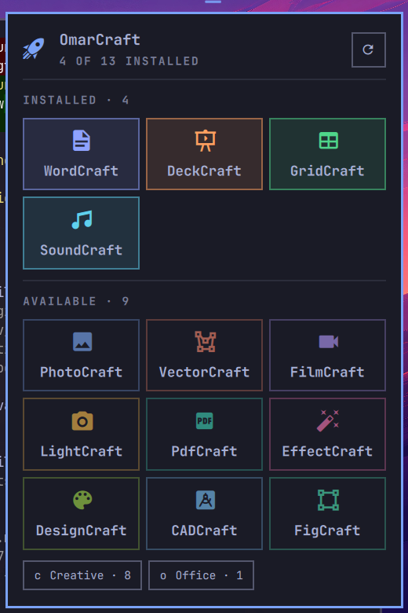

# OmarCraft

The ArtCraft Craft apps, one click from the Omarchy bar.



[ArtCraft](https://getartcraft.com) ships thirteen creative and office apps (PhotoCraft, VectorCraft,
FilmCraft, LightCraft, PdfCraft, EffectCraft, DesignCraft, WordCraft, DeckCraft, GridCraft, CADCraft,
SoundCraft, FigCraft) plus ArtCraft Studio for AI image and video. OmarCraft puts them behind one bar icon:
launch what you have, install what you don't, one app or a whole group at a time, and get told when newer
builds are out. Installs use the prebuilt `-bin` packages from the AUR, so pacman owns every app and nothing
is ever compiled.

Plugin id `omarcraft.productivity`. MIT licensed. **Unofficial**: OmarCraft is not made by or affiliated with
Storyteller, the makers of ArtCraft. ArtCraft and the app names are theirs.

## How it works

OmarCraft is two pieces in one plugin folder:

- **The bar widget** (`BarWidget.qml`) is the icon. It does no work itself: a click runs the script, and a
  timer asks the script every six hours whether updates are waiting.
- **The script** (`bin/omarcraft`) does everything else. It is plain Bash on top of Omarchy's own tools,
  so the picker, terminals and launches look exactly like the rest of Omarchy.

What happens when you click the icon:

1. The script loads the **catalog**: which Craft apps exist (read from the official ArtCraft Launcher's
   source on GitHub) and their newest prebuilt version (one request to the AUR). Both are cached for 24
   hours, so most clicks make no network request at all. Offline, a built-in list of the 13 apps is used.
2. It reads your installed packages once (`pacman -Q`) and works out each app's state: installed, update
   ready, available, new, or not packaged yet (hidden).
3. It opens the **picker** (Omarchy's `omarchy-menu-select`). Your choice decides the action:

| You pick | OmarCraft does |
|---|---|
| An installed app | Launches it, or focuses its window if it's already open |
| An available app | Installs `<app>-bin`, then launches it |
| An app marked update ready | Installs the newer build, then launches it |
| *Update apps* | Installs every newer build in one go |
| *Install Classic / New / all* | Installs every missing app of that group in one go |
| *ArtCraft Studio* | Opens the Studio web app (creates it on first use) |

Every install or update runs in **one floating Omarchy terminal with one `yay` run**, however many apps are
involved. `yay` downloads the prebuilt release, checks its checksum and hands it to pacman. That is why
nothing compiles and why an install takes seconds, not hours.

## Requirements

- Omarchy 4 (Quattro).
- `yay`, `curl` and `jq`, all part of a standard Omarchy install.

## Install

```bash
omarchy plugin add https://github.com/dreamsgarage/OmarCraft.git --enable
```

What that does:

1. Omarchy warns that plugins run unsandboxed inside the shell and asks you to confirm.
2. It clones this repository into `~/.config/omarchy/plugins/omarcraft.productivity/`, checks it with
   `omarchy plugin validate`, and places the icon on the left of the bar, after the workspaces.
3. Nothing else. No script runs at install time, nothing is copied outside the plugin folder, and no
   ArtCraft app is installed until you pick one.

If the add prints "omarchy-shell is not responding", the shell was still reloading its plugins. The plugin is
installed; place the icon with `omarchy plugin enable omarcraft.productivity`.

What OmarCraft writes once you use it, all of it yours to delete:

| Path | What |
|---|---|
| `~/.cache/omarchy/omarcraft/catalog.tsv` | Catalog cache (refreshed every 24 hours) |
| `~/.local/state/omarchy/omarcraft/` | Which apps you've already seen (for "new") and the last update notification |
| `~/.local/share/applications/ArtCraft.desktop` | The Studio web app, after your first right-click |

Updating the plugin itself: `omarchy plugin update omarcraft.productivity`.

## User guide

**Open the picker** by left-clicking the palette icon on the bar (or with the optional keybinding below).
Type to filter, Enter to choose, Esc to close.

**Install an app.** Pick it. A floating terminal opens, shows the Omarchy logo and runs `yay`. Type your
password when asked; that prompt is yay's own, in the open, and OmarCraft never calls sudo or pkexec itself.
When it's done the terminal shows Omarchy's done screen and the app launches. From then on it is in the
picker as installed and in the Omarchy app launcher (`Super + Alt + Space`) like any other app.

**Install several at once.** Pick *Install Classic* (PhotoCraft, VectorCraft, FilmCraft, LightCraft,
PdfCraft, EffectCraft, DesignCraft), *Install New* (WordCraft, DeckCraft, GridCraft, CADCraft, SoundCraft,
FigCraft) or *Install all*. Only the apps you don't have yet are installed, all in one terminal and one
password prompt. Each group row disappears once the group is complete.

**Launch an app.** Pick it in the picker, or use the Omarchy app launcher. If it's already open, the picker
focuses its window instead of starting a second copy.

**ArtCraft Studio.** Right-click the icon. Studio has no Linux build (only a source package that needs a
long Rust and Node build), so OmarCraft opens it as an Omarchy web app at `https://app.getartcraft.com` and
adds it to the app launcher on first use. It needs an ArtCraft account; generation runs in their cloud, so
no local GPU is needed.

**Updates.** Every six hours the icon checks the AUR for newer builds of the apps you installed through
OmarCraft. When there are some:

- the icon turns to the urgent colour and its tooltip lists them (`WordCraft 0.7.0-1 → 0.8.0-1`);
- one notification appears for that set of updates (not every six hours); clicking it updates them;
- the picker leads with *Update apps*.

Middle-click the icon to check right away. `omarchy update` also updates these apps, since it upgrades AUR
packages. "Newer" means a newer AUR build exists, which can trail an ArtCraft release by a day or so.

**New apps.** When ArtCraft adds an app and its `-bin` package reaches the AUR, it appears in the picker with
a star and you get one notification.

**Good to know**

- Leave the install terminal open until it shows the done screen. Closing it while `yay` is still
  downloading just cancels; pick the app again later. Avoid closing it while pacman is installing.
- One package install at a time: pacman allows only one. If another `yay` or `pacman` is already
  installing, the second stops with a database lock error. Wait and pick again.
- To remove an app: `omarchy pkg drop <app>-bin`, for example `omarchy pkg drop photocraft-bin`.

## Apps installed some other way

OmarCraft recognises apps it did not install. It never removes or replaces anything on its own.

| How the app got there | In OmarCraft |
|---|---|
| `<app>-bin` from the AUR (by hand or another tool) | Same as if OmarCraft installed it: launch, update checks, group installs skip it |
| Source build from the AUR (`<app>`, e.g. through the `storytold-suite` or `storytold-office` bundles) | Shown as installed, launches, and group installs skip it. **Not** included in OmarCraft's update checks; `omarchy update` updates it by compiling again |
| AppImage or Flatpak from the official ArtCraft Launcher | Not detected: the picker offers to install the `-bin` package. Remove the AppImage/Flatpak first if you want only one copy |

To move a source-built app to the prebuilt package, so it updates in seconds and shows in OmarCraft's update
checks, remove the source build and install the `-bin` one. The bundle packages stay satisfied, because each
`-bin` package provides the app name:

```bash
yay -S wordcraft-bin    # yay asks to remove the conflicting source package "wordcraft": answer y
```

## Optional extras

None of these are done for you; OmarCraft does not change your configuration on its own.

**A keybinding.** Add this line to `~/.config/hypr/bindings.lua` (`Super + Alt + A` is free on a default
Omarchy 4 install):

```lua
o.bind("SUPER + ALT + A", "OmarCraft", "omarchy-shell omarcraft.productivity open")
```

**An ArtCraft section in the Omarchy menu** (`Super + Alt + Space` root menu and *Install → ArtCraft*):

```bash
~/.config/omarchy/plugins/omarcraft.productivity/bin/omarcraft setup-menu    # add
~/.config/omarchy/plugins/omarcraft.productivity/bin/omarcraft remove-menu   # remove
```

It writes one marked block into `~/.config/omarchy/extensions/omarchy-menu.jsonc` and leaves the rest of
the file untouched. `omarchy menu summon ac` opens it.

## Command line

The picker is a front end for one script, which scripts and keybindings can call too (from the plugin
folder, `~/.config/omarchy/plugins/omarcraft.productivity/`):

```
bin/omarcraft menu                 # the picker
bin/omarcraft launch <id>          # e.g. photocraft
bin/omarcraft install <id>...      # one or more apps
bin/omarcraft install-group all|classic|new
bin/omarcraft check                # pending updates; exit 0 if any
bin/omarcraft update
bin/omarcraft studio
bin/omarcraft list                 # catalog with install state
bin/omarcraft refresh -f           # re-read catalog and versions now
```

IPC: `omarchy-shell omarcraft.productivity open` and `omarchy-shell omarcraft.productivity refresh`.

## Remove

```bash
omarchy plugin remove omarcraft.productivity
```

That deletes the plugin folder and its bar entry. Apps you installed stay installed; remove them like any
package, for example `omarchy pkg drop photocraft-bin`. Optional clean-up:

```bash
~/.config/omarchy/plugins/omarcraft.productivity/bin/omarcraft remove-menu   # before removing, if you ran setup-menu
rm -rf ~/.cache/omarchy/omarcraft ~/.local/state/omarchy/omarcraft            # catalog cache and state
rm -f ~/.local/share/applications/ArtCraft.desktop                           # the Studio web app
```

and delete the keybinding line if you added it.

## Files

| Path | Role |
|---|---|
| `manifest.json` | Plugin manifest: `kinds: ["bar-widget"]`, entry point `BarWidget.qml` |
| `BarWidget.qml` | Bar icon, six-hour update check, IPC (`open`, `refresh`) |
| `bin/omarcraft` | Catalog, picker, install, update, Studio and the optional menu section |
| `tests/` | `bash tests/run.sh`; offline, never touches the network, pacman or your config |
| `docs/` | Testing guide, publish guide and marketplace submission |

Only `<id>-bin` packages are ever installed. The `storytold-suite` and `storytold-office` bundles and the
official `artcraft-launcher` package depend on source builds, so OmarCraft deliberately avoids them.

## Development

```bash
bash tests/run.sh
rsync -a --delete --exclude .git ./ ~/.config/omarchy/plugins/omarcraft.productivity/
omarchy restart shell        # after changing BarWidget.qml
```

Manual test plan: [docs/Testing.md](docs/Testing.md). Shell log: `journalctl --user _COMM=quickshell`.
Release and marketplace steps: [docs/Publish-Guide.md](docs/Publish-Guide.md). Changes:
[CHANGELOG.md](CHANGELOG.md).

## Credits and license

MIT, see [LICENSE](LICENSE). By Entangled Forge. The Craft apps, ArtCraft Studio and the app catalog are by
[Storyteller](https://github.com/storytold); the `-bin` packages are maintained by their AUR packagers.
